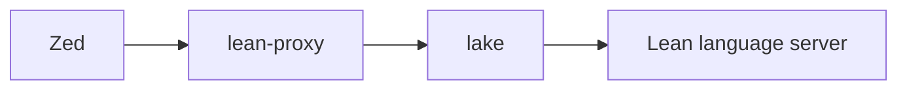

# Zed Lean 4

[Lean(4) Theorem Prover](https://lean-lang.org/) support for [Zed](https://zed.dev), with proof goals, Unicode input, diagnostics, and snippets.

- Tree-sitter: [tree-sitter-lean](https://github.com/Julian/tree-sitter-lean)
- Language Server: [Lean Language Server](https://github.com/leanprover/lean4/tree/master/src/Lean/Server)

## Getting started

1. Install **Lean 4** from Zed's Extensions view (`Ctrl+Shift+X` / `Cmd+Shift+X`).
2. Install [elan](https://github.com/leanprover/elan#installation), Lean's version manager. For a default toolchain, run `elan default leanprover/lean4:stable`. Check that `lake --version` works in your project directory.
3. Open the Lean project folder containing `lakefile.toml` or `lakefile.lean`, then open a `.lean` file.

The extension starts the language server and opens InfoView on the first use in a project. No extension settings are required when Lake is already available. The [recommended settings](#configuration) enable richer highlighting, inline diagnostics, and Markdown preview.

## How it works

When you open a `.lean` file, the extension:

1. Locates Lake using `lsp.lean4-lsp.binary`, then `PATH`, then `$ELAN_HOME/bin` or the default `~/.elan/bin`. If Lake is missing, startup stops unless `elan_auto_install` is enabled.
2. Resolves `lean-proxy` if enabled: an explicit `proxy.path` takes priority; otherwise a cached binary is reused or downloaded from [GitHub Releases](https://github.com/reuixiy7/zed-lean4/releases). Downloads target your operating system and architecture and are stored in Zed's extension work directory.
3. Returns the startup command to Zed. Each arrow below means "starts":



Lake supplies the project environment and starts Lean's language server (`lean --server`). Lean checks the code; the proxy forwards LSP messages between Zed and Lean, adds Unicode input and declaration status, and writes goals to `.lake/InfoView.md` for Zed's Markdown preview.

The proxy download first tries the extension's `v<version>` release, then the latest stable release if that tag cannot be resolved. If downloading fails, it tries an older cached binary. Without an available proxy, or with `proxy.enabled: false`, Zed starts Lake directly; standard language-server features remain available.

Elan installation is separate and **disabled by default**. Setting `elan_auto_install: true` allows the extension install a missing elan with a default Lean toolchain. An existing elan may still download the version requested by a project's `lean-toolchain` file.

## Features

### InfoView

InfoView shows proof goals, expected types, and messages at the cursor and throughout the file. Changed goal lines are marked with `-- ✱`. Tactic goals also appear on hover.

InfoView uses a generated Markdown file in Zed's Markdown preview. It opens once per project; Zed restores it with the layout afterward. Move it into a right-hand split for side-by-side use. To reopen it, use [Open InfoView](#commands) or open `.lake/InfoView.md`.

### Unicode input

Type a backslash followed by an abbreviation:

- `\alpha` becomes `α` as soon as it is unambiguous.
- `\R` followed by a space becomes `ℝ`; the space is kept. A space, punctuation, or newline also completes partial input such as `\alp`, choosing the shortest match.
- Accept a Unicode completion with **Tab** to convert without adding a space. If suggestions are hidden, run `editor: show completions`; otherwise Tab keeps its normal editor behavior.
- Paired abbreviations such as `\<>`, `\[[]]`, and `\norm` insert `⟨⟩`, `⟦⟧`, and `‖‖`, with the cursor inside.

Hover a Unicode symbol to see its input abbreviations. Use [Show Unicode Input Abbreviations](#commands) to browse the full table; `$CURSOR` marks the insertion point in paired symbols.

### Diagnostics and proof status

Lean reports errors and warnings as you edit. The proxy adds these status markers:

| Marker | Meaning                                                                       |
| ------ | ----------------------------------------------------------------------------- |
| ✅     | Lean accepted a theorem or propositional `example` without errors or `sorry`. |
| ⚠️     | The declaration uses `sorry`.                                                 |
| ❌     | Lean reported an error.                                                       |

Enable inline diagnostics to display messages beside the code. `Try this:` suggestions are condensed to one line; apply them with Zed's code actions (`Ctrl+.` / `Cmd+.`).

### Highlighting and snippets

[Tree-sitter Lean](https://github.com/Julian/tree-sitter-lean) provides syntax highlighting, outline entries, and text objects. The grammar is experimental; combine it with Lean's semantic highlighting using `semantic_tokens: "combined"`.

[Bundled snippets](snippets/lean%204.json) provide templates for declarations, namespaces, and proof blocks. Type a keyword such as `theorem`, `namespace`, or `calc`, select the snippet, and use Tab to move between placeholders. Add your own with `snippets: configure snippets` in the Lean 4 scope. Syntax highlighting and snippets work independently of the proxy.

### Nested Lean projects

If Zed opens a parent folder, set `lean_project_dir` to the subdirectory containing the Lake file, for example `"lean_project_dir": "formalization"`. The extension passes it to Lake as `--dir`, so the server uses that project's dependencies.

Relative paths start at Zed's worktree root; absolute paths also work. An explicit `lsp.lean4-lsp.binary` supplies its own arguments, so include `--dir` there when needed.

### Commands

Focus a Lean file, run `lsp command selector: toggle` from Zed's command palette, and choose a command. Neither requires arguments.

| Command                                    | Action                                                            |
| ------------------------------------------ | ----------------------------------------------------------------- |
| `Lean 4: Open InfoView`                    | Open the configured `infoview.file` without clearing its goals.   |
| `Lean 4: Show Unicode Input Abbreviations` | Generate and open `AbbreviationView.md` beside the InfoView file. |

Both commands require the proxy and Zed's `window/showDocument` support. The abbreviation reference remains available when Unicode input or InfoView is disabled.

## Configuration

Merge this example into your **user** `settings.json`. The Markdown options affect all Markdown files. The extension options shown below use their defaults and can be omitted.

```json
{
  "languages": {
    "Lean 4": {
      "semantic_tokens": "combined"
    }
  },
  "diagnostics": {
    "inline": { "enabled": true }
  },
  "markdown_preview": {
    "open_markdown_files_in_preview": true,
    "limit_content_width": false
  },
  "lsp": {
    "lean4-lsp": {
      "settings": {
        "proxy": {
          "enabled": true,
          "auto_download": true
        },
        "infoview": {
          "enabled": true,
          "auto_open": true,
          "hover": true
        },
        "abbreviations": true,
        "declaration_status": true
      }
    }
  }
}
```

All settings in this table belong in `lsp.lean4-lsp.settings`. Dots indicate nested JSON objects. Restart the Lean language server after changing these settings.

| Setting                  | Default             | Effect                                                                                                                                                 |
| ------------------------ | ------------------- | ------------------------------------------------------------------------------------------------------------------------------------------------------ |
| `proxy.enabled`          | `true`              | Enable the proxy and its features. `false` skips its lookup, download, and startup.                                                                    |
| `proxy.auto_download`    | `true`              | Allow proxy downloads. `false` uses only a local or cached binary, falling back to Lake directly if none is available.                                 |
| `proxy.path`             | unset               | Use a local proxy binary instead of downloading one.                                                                                                   |
| `infoview.enabled`       | `true`              | Enable the goal file, open command, and tactic-state hover. Other proxy features are independent.                                                      |
| `infoview.file`          | `.lake/InfoView.md` | Set the output path. The default is relative to `lean_project_dir`, or the worktree root if unset. Explicit relative paths start at the worktree root. |
| `infoview.auto_open`     | `true`              | Open InfoView on first use; `false` still allows manual opening and file updates.                                                                      |
| `infoview.hover`         | `true`              | Show tactic goals on hover while InfoView is enabled.                                                                                                  |
| `abbreviations`          | `true`              | Enable Unicode input, completions, and Unicode hover hints.                                                                                            |
| `declaration_status`     | `true`              | Enhance diagnostics with proof status and compact suggestions.                                                                                         |
| `lean_project_dir`       | unset               | Select a nested Lean project.                                                                                                                          |
| `elan_auto_install`      | `false`             | Install elan and a default toolchain if Lake cannot be found.                                                                                          |
| `elan_default_toolchain` | `"stable"`          | Choose the toolchain for that installation, such as `"nightly"` or `"v4.28.0"`.                                                                        |

**Download controls:** `proxy.auto_download` and `elan_auto_install` are independent. Turning off InfoView, abbreviations, or declaration status does not disable proxy downloads. `infoview.enabled: false` stops goal queries and file updates, including tactic-state hover, while keeping other proxy features. Existing generated files remain on disk.

**Custom binaries:** Set `lsp.lean4-lsp.binary.path` and `binary.arguments` to override the Lake command, for example a Lake path with arguments `["serve", "--"]`. This overrides automatic Lake detection and the `lean_project_dir` argument. For a local proxy, build with `cargo build -p lean-proxy --release` and set `proxy.path` to `target/release/lean-proxy` (`lean-proxy.exe` on Windows). Relative `proxy.path` values start at the worktree root; explicit binaries must exist and be runnable.

## Development

See [Developing Extensions](https://zed.dev/docs/extensions/developing-extensions) for loading a development extension. Run `cargo test --workspace` to check both the extension and proxy.
